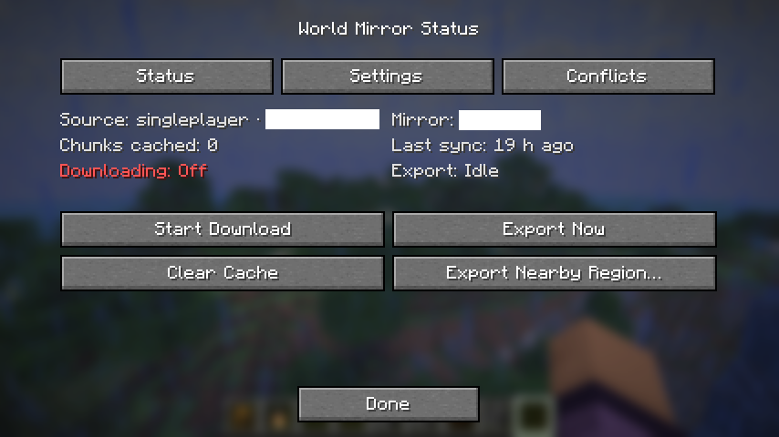
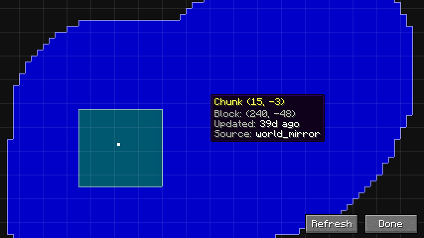
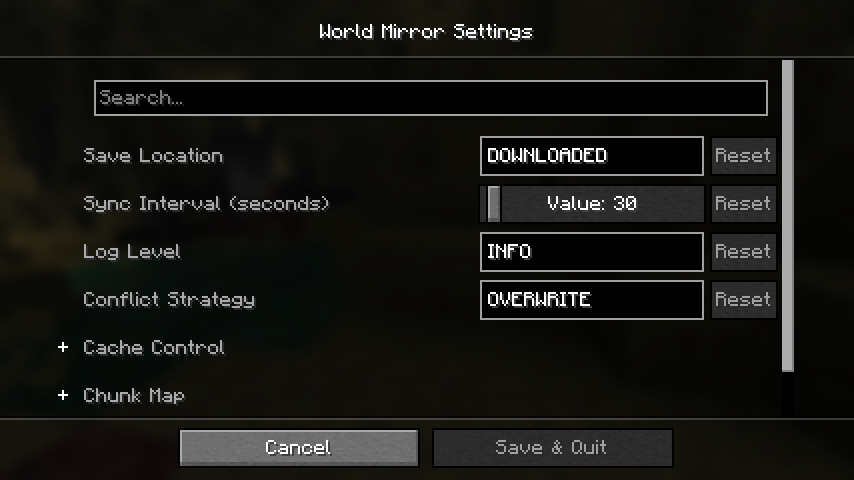
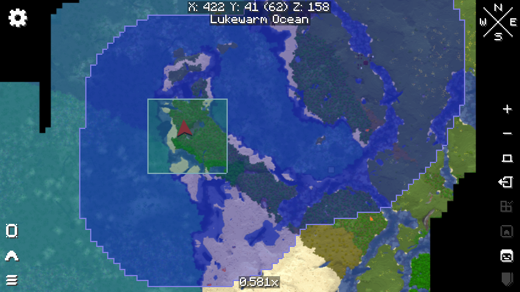
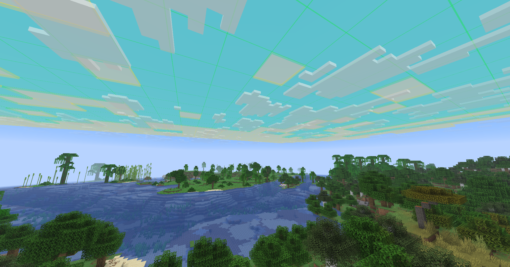
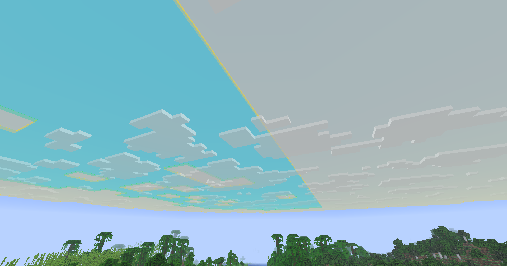

# World Mirror

**Version:** 0.5.2 · **Minecraft:** 1.21.11, 26.1.2, 26.2, 26.3 · **Loader:** Fabric

A client-side Fabric mod that mirrors the world you are playing on a multiplayer server —
or even a singleplayer world — into a standard local save. As you explore, the mod captures
client-visible chunk terrain, block entities, best-effort entity snapshots, and opened
container contents. Choose the `Saves Folder` output mode to make the mirror appear directly
in Minecraft's singleplayer world list.

---

## Features

| Feature | Description |
|---------|-------------|
| **Persistent download session** | Press **P** to start or stop a download session. Chunks received from the server are recorded automatically while the session is active. |
| **Stable and adaptive pipelines** | Hardened periodic sync remains the default. An opt-in adaptive mode reacts to coalesced chunk changes with bounded durability latency. Both use main-thread capture budgets and low-memory, one-region-at-a-time background writes. |
| **Timestamp- and source-aware writes** | SQLite records successful per-chunk write times and source priorities. Older snapshots and updates outranked by a third-party source are skipped. |
| **Multi-dimension support** | Overworld, Nether, End, and custom dimensions are exported using the save layout required by the selected Minecraft version. |
| **Entity capture** | Vanilla-serialized, client-visible non-player entities and passenger trees are merged into per-dimension entity region files. Versioned partial/complete observations reconcile UUID moves and safe despawns without erasing last-known data from unloaded chunks. |
| **Container tracking** | The mod intercepts inventory packets when you open a chest, barrel, hopper, furnace, or any other container and saves the item stacks. They are merged into the block entity NBT on export. Double chests are handled correctly (each half is saved to its own position). |
| **Block entity data** | Signs (text), beacons (effects), banners (patterns), player heads (owner), lecterns (stored book), and all other block entities whose data the server sends to the client are persisted through Minecraft's chunk serialization path. |
| **World–mirror mapping** | Every detected server address or singleplayer world name is persistently mapped to a sanitised local folder name in `config/worldmirror/mirrors.json`. Different aliases for the same server are currently separate source IDs. |
| **Per-world settings** | Save location and conflict strategy can be overridden per world. Time, weather, and difficulty can also be copied manually from the current source world. |
| **Conflict resolution** | Three built-in strategies for chunks that already exist on disk: *Overwrite* (default), *Ignore* (keep local), and *Manual* (save the server chunk to `conflict_chunks/` in MCA format for later review). |
| **Built-in Chunk Map** | Full-screen draggable and zoomable map of recorded chunks. Shared spatial buckets keep large views responsive. Base colors show freshness/source; markers highlight failed or partial exports and unresolved conflicts. Hover for full export details. |
| **In-world Chunk Overlay** | Toggleable in-world chunk boxes make coverage easy to follow while exploring. Choose Session colors (yellow for queued captures, green for this session, blue for historical chunks and replay imports) or Map colors matching the built-in and Xaero maps. Adjustable render distance and fixed Y height (default 96) help find missed areas and confirm full coverage. |
| **Xaero's World Map Overlay** | Optionally render the same status layer on Xaero's fullscreen map through Xaero World Map Bridge. Xaero's World Map and the bridge are both required for this integration. |
| **Export Nearby Region** | Snapshot loaded terrain and visible non-player entities within a configurable radius (1–50 chunks) into a fresh singleplayer save, starting at your current position and dimension. |
| **Native status UI** | Press **I** to open the native Minecraft status screen. It retains download/export status, mirror information, per-world settings, safe mirror relocation, and conflict actions without a LibGui dependency. |
| **Diagnostics** | Storage failures and export outcomes are recorded in `latest.log`. Automatic and manual export failures produce merged chat/toast notices, with current health on the status screen. Optional performance logging adds pipeline, heap, and slow-region telemetry. |
| **Cloth Config settings** | Global settings are available from the status screen. Installing Mod Menu also exposes the same screen from the title-screen mod list. |
| **Internationalisation** | UI strings are translated into English (`en_us`), Simplified Chinese (`zh_cn`), Traditional Chinese (`zh_tw`), and Japanese (`ja_jp`). |

---

## Keybindings

| Key | Action |
|-----|--------|
| **P** | Toggle download session on / off |
| **O** | Export cached data to disk immediately |
| **L** | Clear all cached chunks, entities, and containers |
| **I** | Open the in-game status screen |
| **M** | Open the chunk map directly |
| **K** | Toggle the in-world chunk overlay for the current world type |

All keybindings are rebindable in *Options → Controls → World Mirror*.

---

## In-Game Status Screen (I key)



The status screen shows:

- **Source info** — type (singleplayer / server), source ID, local mirror folder name
- **Statistics** — total chunks cached across all dimensions and the age of the latest
  saved terrain capture
- **Live status** — download active/inactive, export running/idle
- **Action buttons** — Start/Stop Download, Export Now, Clear Data, **Export Nearby Region**
- **Conflicts tab** — count of stored conflict chunks, with *Overwrite All* and *Discard All* buttons, plus **Open Chunk Map** to review conflicts per-chunk
- **Per-world settings** — save-location and conflict-strategy overrides stored in `mirrors.json`, plus manual time, weather, and difficulty sync actions; moving an existing mirror requires confirmation and is blocked while downloading or exporting
- **Integration status** — output path and Xaero World Map Bridge availability
- **Global Settings** — shortcut to the Cloth Config-generated settings screen

---

## Built-in Chunk Map (M key)



Drag to pan, use the mouse wheel to zoom, and hover a cell to inspect its chunk
coordinates, update age, and update source. The map queries an asynchronous,
viewport-indexed status snapshot rather than the SQLite database from the render loop.
At low zoom it aggregates chunks into bounded buckets and merges same-state runs and
boundaries. The built-in map, Xaero layer, and both world-overlay color modes share
spatial queries and cached bucket facts; each view keeps its own derived geometry.
Partial buckets use only coordinates inside the viewport. Clicking a conflicted
chunk opens the **Overwrite / Discard / Cancel** dialog.

---

## Configuration



Click **Global Settings** in the status screen. If Mod Menu is installed, the same screen
is also available from *Mod Menu → World Mirror → Settings*.

| Setting | Values | Default |
|---------|--------|---------|
| Save location | `Downloaded Folder` / `Saves Folder` | `Downloaded Folder` |
| New mirror time | `Follow Current World` / `Morning` | `Follow Current World` |
| New mirror weather | `Follow Current World` / `Clear` | `Follow Current World` |
| New mirror difficulty | `Follow Current World` / `Peaceful` | `Follow Current World` |
| Sync interval / adaptive maximum durability latency | 5–600 s | 30 s |
| Download pipeline | `Stable Periodic` / `Experimental Adaptive` | `Stable Periodic` |
| Conflict strategy | `Overwrite` / `Ignore` / `Manual` | `Overwrite` |
| Maximum cached chunks | 0–12800; 0 disables the limit | 0 |
| Maximum cache distance | 0–64 chunks; 0 disables the limit | 32 |
| Maximum cache age | 0–14400 s; 0 disables the limit | 1800 s |
| Invalidate cache after export | `true` / `false` | `true` |
| Main-thread capture scheduling ceiling | 250–5000 µs/tick | 1500 µs/tick |
| Adaptive dirty high watermark | 32–8192 chunks | 512 chunks |
| Adaptive high-watermark export cooldown | 1–60 s | 10 s |
| Maximum pending capture hints | 512–32768 | 8192 |
| Performance diagnostic logging | `true` / `false` | `false` |
| Slow-region diagnostic threshold | 50–10000 ms | 500 ms |
| Sparse-map cell threshold | 1–16 px | 1 px |
| Chunk-map background | `Black` / `Transparent` | `Black` |
| Xaero overlay enabled | `true` / `false` | `true` |
| Xaero overlay refresh | 1–60 s | 10 s |
| Xaero overlay max cells | 1000–50000 | 6000 |
| In-world chunk overlay (source worlds) | `true` / `false` | `false` |
| In-world chunk overlay (mirror worlds) | `true` / `false` | `false` |
| Show in-world overlay while F1 hides the GUI | `true` / `false` | `false` |
| In-world overlay distance | 8–16384 chunks, direct input | 128 chunks |
| In-world overlay height | -64–319 | 96 |
| In-world overlay colors | `Session` / `Map` | `Session` |
| Show same-status grid lines | `true` / `false` | `true` |
| In-world overlay opacity | 0–100% of original | 60% |
| On join / dimension change / server-world change | `Start` / `Stop` / `Keep` | `Stop` / `Keep` / `Stop` |
| Capture nearby before export | `true` / `false` | `true` |
| Capture nearby on stop | `true` / `false` | `false` |
| Export cached chunks on stop | `true` / `false` | `false` |

Configuration is persisted in `<.minecraft>/config/worldmirror.json`.

Cache age, distance, and count settings evict only data already saved successfully.
Unsaved terrain stays available for retry and may exceed these retention limits
while export or storage is failing. Clearing the cache with **L** explicitly
discards live capture data. Queued or running exports retain their frozen
snapshots and can still finish or retry.

### Optional Xaero integration

The Xaero overlay is an optional integration: World Mirror runs normally without
Xaero's World Map or the bridge. To enable it, install a matching Minecraft-version
build of [Xaero World Map Bridge](https://github.com/billstark001/xaero-world-map-bridge/releases)
alongside [Xaero's World Map](https://modrinth.com/mod/xaeros-world-map).
Use bridge 0.1.2 or newer for every supported Minecraft version; bridge 0.1.0
has an Xaero version upper bound. For Minecraft 26.3, use its 26.3 bridge
artifact with Xaero's World Map 1.46.x. World Mirror's
Chunk Map settings control whether and how often its layer is rendered. The bridge's own
Mod Menu page controls exact mixin injection and the safe tail fallback; World Mirror
only supplies the chunk-status layer through the bridge API.

The built-in map and Xaero overlay use the same live colours. Yellow means a
chunk without a saved record is waiting for capture; yellow-green means a saved
record already exists but a new capture is pending. Bright lime means a new
in-memory capture is waiting to be saved, and light green means that an older
saved record already exists while the new capture waits to be saved. After terrain
and its index commit, chunks return to the green-to-blue capture-age gradient.
Orange identifies sources other than `world_mirror` and `replay_import`, including
registered third-party sources; it does not mean only an unknown source.
Purple marks unresolved conflicts. A pending light update can also temporarily appear
as waiting for capture.

Only the built-in chunk map adds export warning markers and conflict hints:

| Marker | Export state |
| --- | --- |
| Red cross | All required writes failed |
| Red/green split | Partially saved, with unfinished work retained |
| Purple border | Unresolved conflict |

Queued, writing, and successful exports have no corner glyphs. Hover a chunk for
its full export state, separate terrain/entity results, and metadata status.
These warnings preserve the base colors; a red accent remains during a retry until
its previous failure is resolved, and purple conflict borders can coexist with
failures. Cells smaller than eight GUI pixels use simple dots: red for failure,
light red for partial failure, and purple for conflicts. Coarse buckets retain
unresolved failures; zoom in to inspect individual chunks. Frozen work remains
available after its live cache is cleared. Xaero and the in-world overlays keep
their coverage colors and boundaries without export or conflict corner glyphs.

Export observations last for the current client process. Existing database rows
prove historical terrain coverage, not entity completion, so reopening the client
reports historical terrain without inferring entity completion. Map refreshes remain
asynchronous: stable views refresh changed live data at most every 0.5, 1, or 5
seconds as their chunk extent grows. Status readers use immutable region pages;
an export updates only the changed pages. Observed chunk metadata still grows
with the number of chunks seen during this client run, without retaining NBT.

Automatic and manual export failures produce merged chat and top-right toast
notifications. Repeated notices for one source are limited to once per 30 seconds;
escalation and recovery can arrive sooner, with at least two seconds between
deliveries. The status screen keeps the current counts and failure stage visible.
Partial failures log at WARN; blocked exports and index/metadata failures log at
ERROR. Unfinished work remains available for retry.



### In-world chunk overlay

Based on the original contribution by [@cev-api](https://github.com/cev-api)
in [PR #14](https://github.com/billstark001/world-mirror/pull/14).

The 0.5.0 overlay at 60% opacity and a 24-chunk radius in a normally generated
Minecraft 26.2 world. The same-status interior grid is enabled in the first screenshot and
disabled in the second:





Enable **In-World Chunk Overlay** in the Chunk Map settings to draw one-block-high
status boxes around the player. It makes coverage easy to read while you explore: gaps
stand out immediately, so you can retrace missed areas instead of trying to remember
which parts of the world you have already covered. Use it to systematically fill in
the map and confirm that a route or region has full coverage before stopping a download
session.

The boxes keep a consistent fill opacity from above and below. Water and clouds
behind a box no longer paint over it. Solid terrain still hides boxes behind it.

The default **Session** colors show capture-session coverage:

- **Yellow** — capture or a pending light update is queued.
- **Green** — the chunk has been captured during the current download session.
- **Blue** — historical captured coverage, including older in-memory captures,
  or a replay import.

Session base colors describe coverage, including unsaved data. The independent
export markers above distinguish write progress and results in both color modes.

Choose **Map** colors to use the capture-age gradient, source colors, and live
capture/write queue colors described above for the built-in and Xaero maps.

Both world types have separate overlay switches, disabled by default. Press **K**
while playing to toggle the switch for the current world type, or change either
switch in the settings menu. The choices are saved across sessions. The overlay's
render distance (8–16384 chunks, entered directly) and fixed Y height (default 96)
are adjustable in
the same settings group, so the boxes
can be placed where they are easiest to see without obscuring gameplay.
F1 hides the overlay with the rest of the GUI unless the separate F1 setting is enabled.
Terrain above the selected Y height hides the overlay at that spot.
At larger distances, adjacent chunks are grouped into larger tiles to keep the
overlay responsive; use a shorter distance when checking individual chunks.
The same-status grid switch shows boundaries within a single-colour area by default;
turn it off to keep only the outer perimeter and changes in chunk status. At larger
distances, grid lines follow the aggregated tiles. Opacity defaults to 60% of the
original fill and outline strength and can be adjusted in the same settings group.

### Save locations

Generated mirror names use one safe folder segment, including for names such as
`CON` or `..` that cannot be used as ordinary folders on Windows. Invalid folder
paths in a manually edited `mirrors.json` are ignored when previewing or selecting
an output; existing mirror contents are not moved by that fallback.
An export starts only after its selected folder has been saved to `mirrors.json`.
If saving a relocation fails after the folder moves, World Mirror attempts to move
it back and reports the operation as failed. If that rollback also fails, the log
records both paths so the intact folder can be recovered from the destination.

| Mode | Path |
|------|------|
| `Downloaded Folder` (default) | `<.minecraft>/downloaded_worlds/<mirror-name>/` |
| `Saves Folder` | `<.minecraft>/saves/<mirror-name>/` — immediately playable in the world list |

### Conflict strategies

| Strategy | Behaviour |
|----------|-----------|
| `Overwrite` | Incoming chunks that pass timestamp and source-priority checks replace the local copy |
| `Ignore` | Local copy is kept; only new chunks are written |
| `Manual` | Local copy is kept; the incoming server chunk is saved to `conflict_chunks/<dim>/r.X.Z.mca` for review. Use the Chunk Map or the Conflicts tab bulk buttons to resolve. |

Conflict storage uses the classic `region/`, `DIM-1/region/`, `DIM1/region/`, and
`dimensions/<namespace>/<path>/region/` layout on every target. Oversized chunks
may also have a matching `c.X.Z.mcc` file; keep it with its region file when
copying pending conflicts. Overwrite reopens and verifies the applied chunks
before removing their pending entries. A failed write or a newer incoming
version remains pending for another review.

---

## Output Format

The exported world is a standard Minecraft save directory. These files are common to
all supported targets:

```
downloaded_worlds/<mirror-name>/
├── level.dat                       ← Loadable world metadata
├── data/world_mirror.sqlite        ← Dirty-check and source-priority database
├── conflict_chunks/                ← Present when Manual conflicts are pending
├── resourcepacks/
└── worldmirror_meta.json           ← World Mirror metadata
```

Minecraft's dimension layout differs by target version:

| Target | Overworld | Nether | End | Custom dimension |
|--------|-----------|--------|-----|------------------|
| 1.21.11 | `<world>/` | `<world>/DIM-1/` | `<world>/DIM1/` | `<world>/dimensions/<ns>/<path>/` |
| 26.1.2 / 26.2 / 26.3 | `<world>/dimensions/minecraft/overworld/` | `<world>/dimensions/minecraft/the_nether/` | `<world>/dimensions/minecraft/the_end/` | `<world>/dimensions/<ns>/<path>/` |

Each dimension directory contains the target version's `region/`, `entities/`, and
`poi/` structure. World Mirror also creates the player-data and saved-data directories
required by that version.

Minecraft 26.1.2, 26.2, and 26.3 also use `data/minecraft/world_clocks.dat`. World Mirror
generates its payload through Minecraft's `PackedClockStates` codec and automatically
repairs the exact extra `data.clocks` wrapper produced by World Mirror 0.4.0. Other clock
payload shapes are left untouched.

World Mirror checks generator contents as well as metadata when opening a mirror or
starting a download. A recognized obsolete generator can be backed up and repaired
with explicit confirmation, even when its metadata already says it is current.
Unreadable or unrecognized generator edits are preserved and require manual review;
Minecraft's data-pack safe mode does not convert an obsolete inline generator.
Repair retains captured chunks, player data, other dimensions, and valid customized
generators. Repeating a completed repair does not create another backup.

`worldmirror_meta.json` fields:

| Field | Description |
|-------|-------------|
| `modVersion` | Mod version that created / last updated the mirror |
| `format` / `metadataSchema` | Stable World Mirror marker and metadata-document schema |
| `mirrorKind` | `synchronized` mirror or standalone `nearby_export` |
| `mirrorId` | Stable mirror identity that survives folder moves and copies |
| `parentMirrorId` | Optional identity of the mirror from which a nearby export was created |
| `sourceType` | `singleplayer` or `server` |
| `sourceId` | `local:<level-name>` or `server:<address>` |
| `lastSyncTime` | Unix-millisecond capture timestamp of the newest successfully saved chunk. Existing values written by older versions as export completion times are left unchanged. |
| `worldgenSchema` | Semantic schema of the generated mirror dimensions |
| `worldgenAssetRevision` / `worldgenAssetDataVersion` | Global worldgen asset revision (shared by all targets) and the Minecraft data version used to write it |
| `legacyVoidChunkCleanupRevision` | Completion marker for the backed-up legacy void-chunk cleanup |

Per-chunk dirty-check metadata is stored in `data/world_mirror.sqlite`. Older
`worldmirror_meta.json` files with a legacy `chunkUpdateTimes` field are migrated
into SQLite on the first sync after upgrade. The JSON field is removed only after
the database commit succeeds; a failed migration retains the original data and
stops that export for retry. Mapping and metadata JSON are replaced using
same-directory temporary files. A failed final metadata write leaves the export
incomplete and queued for retry. Manual and automatic exports report failures
through coalesced local chat/toast notices as well as the log.
Compressed world-data files are also written to a temporary file and read back
before replacement. Serialization failures and values the NBT writer cannot
preserve leave the previous file intact.
NBT uses the game's strict writer to reject oversized strings and keys. In-place
region writes additionally check strings before opening a committing output stream;
staged files are validated before any live replacement.

World-file mutations hold Minecraft's `session.lock` for the entire operation.
Close the target mirror before exporting into it, applying conflicts, upgrading,
or copying world settings. Conflict review can be performed from the original
source world while its output mirror is closed. Read-only status queries remain
available when a mirror is open.

Failed mirror exports retain only unfinished frozen revisions while the client is
running, even after leaving the source world. The first retry waits 10 seconds;
further failures back off exponentially to 15 minutes. A manual export wakes pending retries immediately. Terrain and entity updates preserve their own
source order: an entity-only failure does not block newer terrain, while a failed
terrain revision must settle before later terrain from that source. Other sources
can proceed. Terrain is acknowledged only after region verification and its SQLite
commit; entity acknowledgement requires separate UUID verification. Retried
metadata saves retain the newest already verified and indexed capture time.

A malformed file affects only work that depends on it. Optional saved-data repair
failures leave the file untouched and allow independent terrain to save; damaged
entity regions still block entity operations whose UUID uniqueness cannot be proved.
Unavailable priority rules defer overwrites. Read failures are not treated as an
empty database or a missing routing document. Invalid configuration is backed up
before normalized settings are saved; an unknown conflict policy becomes Ignore.

NBT/JSON reads have finite budgets. Unchanged malformed NBT is not repeatedly
decoded, and manual export retries validation. File failures outside chunk writes
also produce coalesced local chat/toast notices. Capture stops admitting new work
when retained bundles, dirty chunks or heap pressure exceed the safety budget;
existing unfinished data stays retained. Repair the failure, export, then restart
capture. This does not turn the in-memory retry queue into crash-persistent storage.

Unfinished mirror creation has a durable ownership reservation and resumes the same
directory. Moving a world within the same filesystem holds native locks at both
ends, validates both identities and the complete move plan, and journals the move.
It rolls back if routing cannot be saved. The old empty root retains a reservation
so moving back can reuse it. Interrupted file replacements recover under the native
world lock before subsequent writes or opening through the mirror recovery flow;
ambiguous or corrupt recovery evidence is retained for repair. Recovery never
overwrites content that matches neither the original nor the planned replacement.
Cleanup failures after a verified commit do not reverse it. These guarantees cover
recoverable file operations, not simultaneous multi-file visibility or all hardware
power-loss scenarios.
Bulk conflict application uses bounded batches and removes incoming entries only
after their copied data verifies. A damaged region location table is retained for
repair rather than passed to a writer that could discard its invalid entries.


On client exit, the configured stop-time capture/export behavior runs first. The
export worker finishes accepted writes and makes one final attempt at queued frozen
work without interrupting region replacement. Failed revisions still block dependent
updates in that final pass. The idle worker closes immediately; remaining failed
snapshots are held only in memory and do not survive closing the client.
Saves with a newer `metadataSchema` are treated as future data and are not
rewritten. A different explicit `format` marker is not adopted as a World Mirror
save; legacy metadata without that marker remains supported.

---

## Entity Serialization

On the game thread, World Mirror uses Minecraft's vanilla entity serializer for each
visible top-level non-player entity and its complete passenger tree. Versioned updates
are kept independently from the terrain cache, then merged into per-dimension
`entities/r.X.Z.mca` files with verified, recoverable region replacement, including external `.mcc` payloads. This covers common mobs,
vehicles, paintings, item frames, armour stands, and dropped items on a best-effort basis.

Entity output is not a server-authoritative backup. Fields never sent to the
client—such as AI internals and unopened villager trades—cannot be reconstructed.
UUID indexing removes stale copies when an entity or passenger tree crosses chunk or
region boundaries. Move-source removals affect only their original chunk, so a delayed
cleanup cannot erase an entity already saved at its destination. A departing passenger
is pruned from its old tree without discarding an otherwise unobserved vehicle.
Complete observations can clear moved/despawned entities; partial observations only
upsert what the client positively sees. Changes that revert while an older export is
running retain a corrective revision. When a chunk unloads, its last
known entities are preserved because a client-side mod cannot distinguish every unload
from a server-side removal. Failed entity-region writes retain their exact revisions for
retry, including a stop-time snapshot deferred behind an active export.

Older mirror entity trees missing a type ID can still be indexed and preserved
when every node has a valid UUID. A fresh, valid observation replaces the old copy
by UUID; World Mirror does not guess missing types or discard unindexable data.
Newly captured entity trees still require valid type IDs and UUIDs.

When several capture sessions stop while an export is busy, each frozen world
snapshot receives a separate export pass. Captures queued in the newly opened
world do not delay an already frozen pass from the previous world.

---

## Block Entity Serialization

Block entities are serialized through Minecraft's chunk saving path
(`getBlockEntityNbtForSaving` / `SerializableChunkData`):

- **Signs / Hanging signs** — front and back text, waxed and glow-ink flags
- **Beacons** — primary and secondary effect IDs
- **Banners** — all pattern layers
- **Player heads / Skulls** — owner profile
- **Lecterns** — stored book item
- **All other block entities** — any state the server sends to the client

Container inventories (chests, barrels, hoppers, furnaces, etc.) are handled separately
by the `ContainerTracker`, which intercepts inventory packets when the player opens each
container during the session. Previously captured non-empty container item data is
preserved when later client block-entity snapshots are empty, and default GUI titles such
as `container.chest` are not persisted as custom names.
Literal names such as `Chest` and styled or extended translated names are retained.
Inventory capture is tied to the opened client world and block-entity type, so a
stale chest overlay is not applied to a furnace later placed at the same position.
Ender-chest inventories belong to the player and are not saved into world blocks.
An explicit block update can capture the removal of a chunk's final block. These
confirmed empty captures replace saved terrain without restoring old block
entities. Ordinary all-air observations remain excluded because they may be
server placeholders. Queued block changes are completed before an explicit stop.

Initial and overflow-recovery scans resume from a cursor as queue space becomes
available. A scan larger than the configured hint capacity does not repeatedly
restart from the same corner. Authoritative changes in loaded chunks retain their
capture intent under queue pressure and when coalesced with ordinary load hints.

---

## Capture Limits

World Mirror is client-side and cannot reconstruct data the server never sends. In
particular:

- unopened container inventories, server-only entity fields, structure metadata, and
  server datapack definitions may be absent;
- entities in unloaded chunks retain their last client-known state until that chunk is
  observed loaded again;
- light-only, block, block-entity, biome, container, load, and unload changes are
  coalesced into bounded capture work; data the server never sends is still unavailable;
- uncaptured chunks intentionally remain void, while the generated save's climate and
  dimension metadata can differ from the source world
  ([issue #5](https://github.com/billstark001/world-mirror/issues/5)).

Sources are identified by server address or local level name. Multiple logical
worlds behind one server address share that identity; the server-world transition
setting reacts only to a detected source-ID change.

---

## Installation

Choose the World Mirror JAR that exactly matches your Minecraft version:

| Minecraft | Java |
|-----------|------|
| 1.21.11 | 21 or newer |
| 26.1.2 | 25 or newer |
| 26.2 | 25 or newer |
| 26.3 | 25 or newer |

1. Install [Fabric Loader](https://fabricmc.net/use/) 0.19.5 or newer.
2. Install the matching [Fabric API](https://modrinth.com/mod/fabric-api).
3. Put the matching World Mirror 0.5.2 JAR in `mods/`.
4. *(Optional)* Install [Mod Menu](https://modrinth.com/mod/modmenu) for a title-screen settings entry.
5. *(Optional)* For the Xaero overlay, install a Minecraft-matched
   [Xaero's World Map](https://modrinth.com/mod/xaeros-world-map) and
   [Xaero World Map Bridge](https://github.com/billstark001/xaero-world-map-bridge/releases).
   Use bridge 0.1.2 or newer for the exact Minecraft version. Minecraft 26.3
   needs Xaero 1.46.x.

Cloth Config and SQLite JDBC are bundled in the World Mirror JAR. LibGui is not used
and does not need to be installed.

---

## Typical Usage

Continuous recording requires an active download session, started with **P** or
a lifecycle setting. Manual **O** exports can also run without a session. The
normal workflow is:

1. Join the source world and press **P once**. Confirm that the action bar says World
   Mirror is active.
2. Explore the areas you want to retain. Open each container whose inventory matters;
   unopened inventories are not sent to the client.
3. Leave the session active while exploring. Stable Periodic writes changed chunks on
   the configured interval; pressing **O** is optional and requests an immediate final
   pass. Automatic periodic passes do not rescan a 17×17 area.
4. Press **P** to stop. If “Export cached chunks on stop” is disabled (the default), use
   **O before stopping** when you want a final pass immediately.
5. The default output is `<.minecraft>/downloaded_worlds/`, which Minecraft does not list
   as a singleplayer save. Select **Saves Folder** before downloading if it should appear
   directly in the world list.

Changing the download pipeline while a session is active is intentionally safe: the new
choice applies the next time the session starts. Export requests remain serialized,
and every offline writer acquires the target save's session lock.

### Collecting a performance log

If stutter returns, enable **Performance → Performance Diagnostic Logging**, reproduce it
for at least 30 seconds, then attach `latest.log` and the World Mirror config. Lines marked
`[perf]` first record the complete global and current-world configuration, then report the
active pipeline, cache/dirty counts, capture queue age, coalesced and dropped hints,
main-thread capture time, export duration, slow region files, failures, and heap usage.
Disable the switch afterward; it is designed to be low-frequency but is not needed during
normal play.

Distant Horizons' “slow GC” warning is selected from the JVM garbage collector name and
does not by itself attribute a pause to World Mirror. World Mirror's `[perf]` line includes
`gcCollectors`, `gcCountDelta`, and `gcTimeMsDelta`; compare those deltas with
`captureTickP99Us`, `wmTickP99Us`, `lastExportMs`, and slow-region lines to tell collector
pressure from a capture or disk bottleneck. The 0.4 writer removes World Mirror's previous whole-cache NBT
copy/conversion spike, which can reduce GC pressure without suppressing DH's generic JVM
warning.

### Quick export (no session)

Press **O** at any time to trigger an immediate export, even when no download session
is active. With the default lifecycle settings, the mod first queues a small loaded area
around the player for capture.

### Starting fresh

Press **L** to clear the in-memory chunk, entity, and container caches. This does not
delete or reset any mirror data already written to disk. Previously frozen exports
remain queued and can still write or retry; clearing live caches does not cancel them.

---

## Building

Maintainers should read [CONTRIBUTING.md](CONTRIBUTING.md), especially the
project-wide logging policy and file-failure recovery rules.

```bash
./gradlew buildAll
```

This builds the Fabric targets for Minecraft 1.21.11, 26.1.2, 26.2, and 26.3. Each
target's artifacts are stored in its `versions/fabric-*/build/libs` directory.
Each target uses `libs/xaero-world-map-bridge-<minecraft>.jar`. Run
`./gradlew verifyBridgeMatrix` when updating a target or its bridge artifact;
`buildAll` and IDEA synchronization run the same metadata check automatically.

For a Modrinth upload, build all targets and collect only the four distributable
JARs in the generated root `build/modrinth` directory:

```powershell
.\scripts\build-modrinth.ps1
```

Use `-SkipBuild` only when the current version's four JARs have already been built.

### Development run configurations

Gradle generates a separate IntelliJ IDEA client run configuration for every supported Minecraft target. All targets
intentionally share the root `run/` directory, while their module, Loom launch file, and Java runtime remain
version-specific. Minecraft 1.21.11 uses Java 21; Minecraft 26.x uses Java 25.

Because `run/mods` is shared, enable only the Xaero World Map JAR that matches the client
being launched; the helper script keeps other downloaded versions as `.jar.disabled`.
On this multi-target branch, select the target explicitly:

```powershell
.\scripts\Get-LatestXaerosWorldMap.ps1 -MinecraftVersion 26.3
```

The bridge is compile-only by default. Enable its matching, development-only runtime
artifact with `-PxaeroIntegration=true`; install the matching World Map in `run/mods`
using the helper above. For example:

```powershell
.\gradlew.bat :versions:fabric-26.3:runClient -PxaeroIntegration=true
.\gradlew.bat syncIdeaRunConfigurations -PxaeroIntegration=true
```

For IDEA, also set `xaeroIntegration=true` in your local Gradle properties and reload
Gradle so the module runtime classpath includes the bridge. Remove that local setting
and reload Gradle to return to the default configuration. This does not bundle the bridge
in the published mod or make Xaero mandatory for players.

For a World Mirror-only startup smoke test, use an empty, separate run directory:

```powershell
.\gradlew.bat :versions:fabric-26.3:runClient "-PworldMirrorRunDir=build/smoke/26.3"
```

Leave `xaeroIntegration` unset and keep that directory's `mods` folder empty. Repeat
for all four targets. This verifies actual absence of Xaero and the bridge, separately
from integration testing. `worldMirrorRunDir` also applies to generated IDEA clients.

Reloading the Gradle project refreshes the configurations automatically. They can also be rebuilt from a terminal:

```powershell
.\gradlew.bat syncIdeaRunConfigurations
```

Before regeneration, this removes the old generated configurations, including entries belonging to deleted targets.
When adding or removing a Minecraft target:

1. Update its metadata entry in `build.gradle`.
2. Update the matching `versions/fabric-<minecraft>` project in `settings.gradle` and its source directories.
3. Update the CI, release, and Modrinth matrices in `.github/workflows` and `scripts`.
4. Reload the Gradle project, or run `syncIdeaRunConfigurations`.

`buildAll` derives its project list from `targets`, so it does not need a separate update.

---

## Implementation Notes

Contributor-facing architecture, durability, logging, and file-recovery guidance lives
in [CONTRIBUTING.md](CONTRIBUTING.md). The third-party SQLite contract is documented in
[DATABASE.md](DATABASE.md).

## License

MIT

