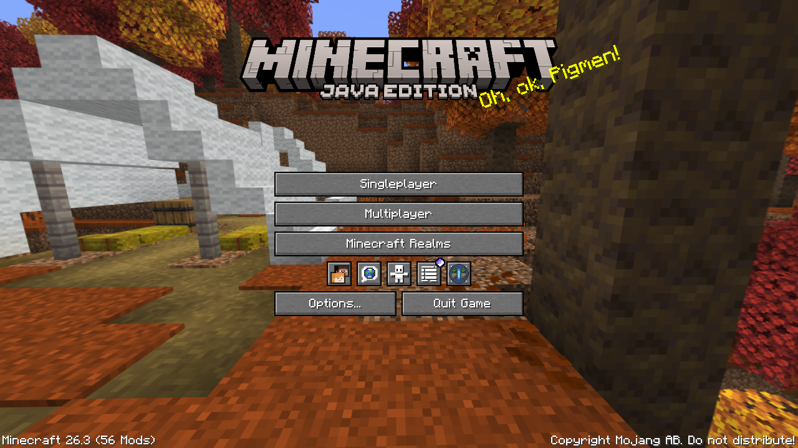
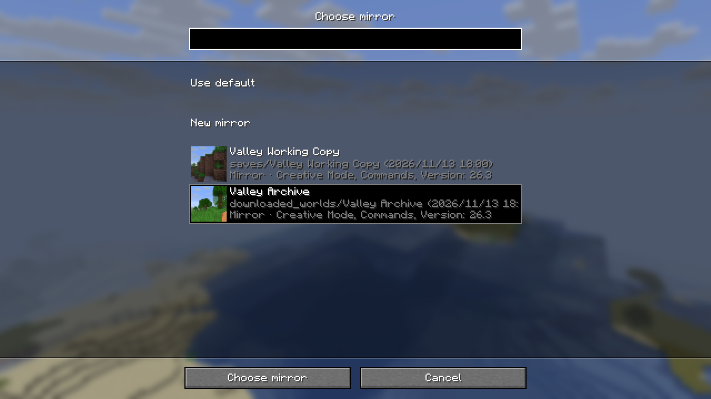
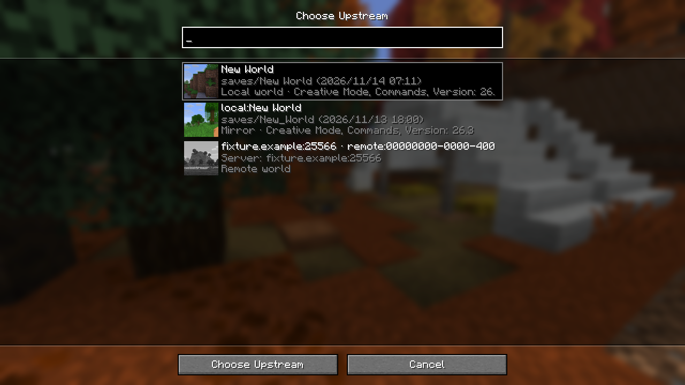
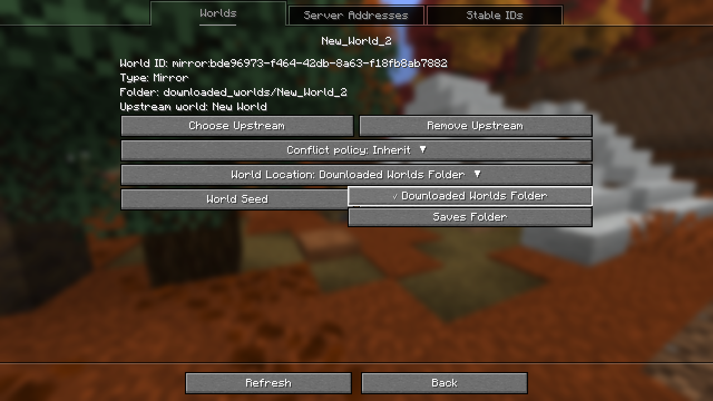
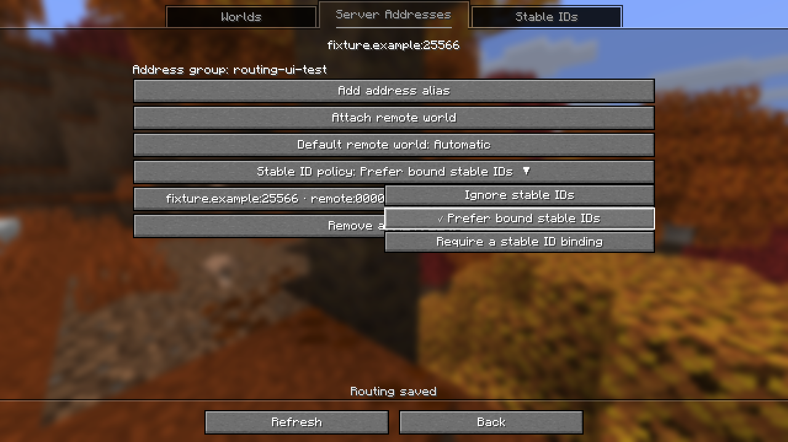
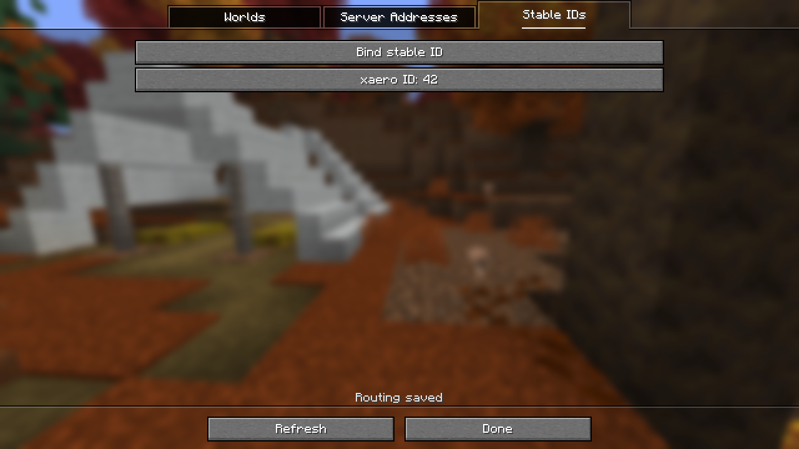
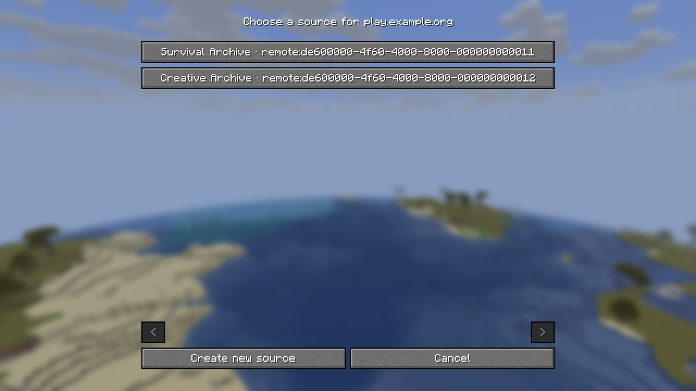

# World routing

Open **World Mirror Routes** with the square World Mirror icon on the title screen or from the in-game status screen's **Settings** tab. Mod Menu opens global settings. A server address can point to several logical worlds, and several addresses can share an address group. A logical world can have multiple download mirrors. A mirror opened in singleplayer is also a possible source for another mirror. The status screen can show the open save or the download destination and can select another direct target or create one for the current session. That selection does not overwrite the saved default.





The **Worlds** tab shows each upstream world and the mirrors that descend from it. Drag to move around the tree and scroll to zoom. Select a world to see its details, then open the details to edit its settings. The fit button returns the whole tree to view. The **Server Addresses** and **Stable IDs** tabs manage the rules that connect servers to those worlds.

In world details, **Choose Upstream** opens the same searchable world list used to choose a download mirror. The list shows which entries are in the saves folder, which are in downloaded worlds, and which are remote servers. Choosing or removing an upstream keeps the world ID and its SQLite namespace. A mirror with no upstream can still be opened, edited, and used as the upstream of another mirror.



Selecting a remote world for an address or a stable ID uses the same searchable picker. Address and alias entry accept text, and the stable ID policy uses a dropdown.

**World Location** selects where a managed world is kept. **Delete** uses Minecraft's world deletion confirmation. Downstream links to a deleted world remain visible as missing.



The **World Seed** action opens offline generator settings. A fresh World Mirror reservation or a recognized void mirror whose metadata is missing can be initialized when you apply the seed. See [mirror seeds](world-seeds.md).

After upgrading from v0.5.4, use **Import Old Local Routes** in the Worlds toolbar to review routes saved under old world names. Choose the original local world to adopt a route, even if it has since been renamed. An existing destination must still belong to the old route before it can be linked. If the destination is missing, importing keeps the old creation preferences. You can also discard an obsolete route from the list. When choosing a local upstream from an old destination's details, the editor offers to import its corresponding route.

## Choosing a source

The client normalizes the address the player entered: host case, IDN, IPv6 and the default port. It does not use DNS/SRV resolution, a display name, the seed, or a dimension as evidence that two logical worlds are the same.

| ID policy          | Source choice                                                                                                                                                                       |
| ------------------ | ----------------------------------------------------------------------------------------------------------------------------------------------------------------------------------- |
| `ENDPOINT_ONLY`    | Use the endpoint default or the only candidate. If there are several candidates and no default, ask.                                                                                |
| `PREFER_BOUND_ID`  | Use a bound advertised ID. Use the endpoint rule when the client has evidence that no ID is available. Ask when an ID is unfamiliar or its use for this session needs confirmation. |
| `REQUIRE_BOUND_ID` | Wait when no ID is available. An unfamiliar or conflicting advertised ID needs explicit selection.                                                                                  |



A binding uses the provider, address group and raw advertised ID. For Xaero, the observation is the signed ID from the decoded level-properties packet; the adapter does not use derived folder names or Xaero's selected map. An unrecognized ID can be assigned a new source at the first download. If a server obfuscates or rotates its IDs, use endpoint-only routing or choose the logical source for each connection. Changing the policy can use an ID already seen on the open connection. The client cannot infer a switch from two servers that present identical evidence. Lack of a packet is not evidence of absence; a provider without reliable ordering can require explicit confirmation at a transition. Dimension changes with unchanged identity retain the same source and target.



Starting a download shows **Preparing mirror…** while the client resolves the route and checks the destination in the background. If the client asks for a source, use **Choose Download Source** in the in-game World Mirror menu. If the destination needs an upgrade, use **Review Mirror Update** there to approve it. Capture becomes active only after the destination is ready. You can cancel a pending start with the download hotkey.



## Storage and writes

- `config/worldmirror/world-graph.json` stores normalized endpoint rules, address groups, candidate/default sources, provider bindings and target preferences. Routing preference changes publish this file atomically. Upstream changes update the child save's metadata or its empty destination reservation under the native lock and refuse cycles.
- Save metadata owns `nodeId`, `parentNodeId` and the physical SQLite `sourceId`. Existing namespaces are preserved. New download mirrors use their logical upstream node ID for their index namespace. A captured batch records all three identifiers. The export worker resolves the mirror node's current path, then rechecks identity, upstream and index namespace under the save lock.
- An ordinary local save receives `worldmirror_identity.json` when the player saves a per-world preference, imports an old route, or first needs the node ID for a download, a linked nearby export, or an upstream selection. Scanning, opening, closing, viewing a path preview, and exporting an independent nearby snapshot keep an untracked save without an identity file. Once assigned, the ID follows the save through a rename or move.
- A session uses its explicit mirror choice first. A source can pin a default mirror or use automatic selection. A verified v0.5.4 default becomes a pin. Automatic selection prefers the last usable automatic target, then chooses an eligible direct mirror in node ID order. Switching to **Automatic** clears the pin. An unavailable pinned mirror keeps its setting, and the player can select a mirror for the session. Nearby exports may record their actual source as a lineage edge or be standalone snapshots.
- Map, overlay, conflict, status and notification state use the concrete mirror ID. A map's live layers apply only to the target owning the corresponding live cache. SQLite reads still use the namespace stored in that mirror's metadata.
- Toolkit validates Replay endpoint provenance separately from the destination index namespace. If the endpoint has several configured logical sources, use `--replay-source` to confirm the source of the recording. Toolkit checks that selection against the destination lineage. Use `--world-graph` to point it at the client's graph if it cannot find the graph beside the save roots.

## Verifying routing changes

Use an isolated game directory. Give one endpoint two logical sources and each source two direct mirrors. Use different terrain at the same coordinates in the same dimension so an accidental cross-write is visible.

1. Give the sources different provider IDs. Check that a bound ID selects its source, an unfamiliar ID asks, and a late ID stops the previous capture before the next session can start. Switch dimensions without changing the ID and check that the destination stays the same.
2. Start capture, select the other mirror for the same source, then return to the first. Check that outstanding retries follow their original mirror and never acknowledge the new session's cache. Compare map and conflict views for both mirrors.
3. With capture stopped and exports finished, attach an alternate address in the title editor, select the existing group, and reopen the editor. Verify the route resolves to the same source and compare the metadata and SQLite file bytes before and after the edit.
4. Import a Replay that names the shared endpoint. The preview must require confirmation even if the mod has a default source for that endpoint. Confirm the correct source, then check that the other logical source is rejected for the same destination.
5. At two GUI scales, check that the square title icon appends to the existing row in 1.21.11 and 26.1.2, and that the group is centered in 26.2 and later. Open routing from the title and the in-game status screen. Switch tabs by mouse and keyboard, check that the footer stays below the content, and use Back to return from a world's settings to the same tree position. Pan and zoom the tree with a missing parent or a multi-level branch visible.
6. Start a download from the hotkey and from the status screen. Check that neither opens another screen. Press the hotkey again while **Preparing mirror…** is shown and check that capture stays inactive after background preparation finishes. A destination requiring approval waits for **Review Mirror Update**. Open, exit, and reopen the resulting mirror. The normal open must continue through vanilla's existing save access after inspection; approved upgrades and recovery reopen from disk.

The standalone MineDriver replay checks hotkey cancellation, retry, and returning from the in-game Routes screen. Use an isolated Minecraft 26.3 Fabric development session at the title screen with default World Mirror settings, English (US), and the default **U** and **I** bindings. Launch the target's interactive `mineDriverRun` task using a local MineDriver plugin setup. Pass its current per-run report directory to Python from this repository. The replay creates and downloads a disposable flat world in that session.

```sh
python scripts/manual-tests/download-preparation.py "versions/fabric-26.3/build/reports/minedriver/mineDriverRun/<run-id>"
```
