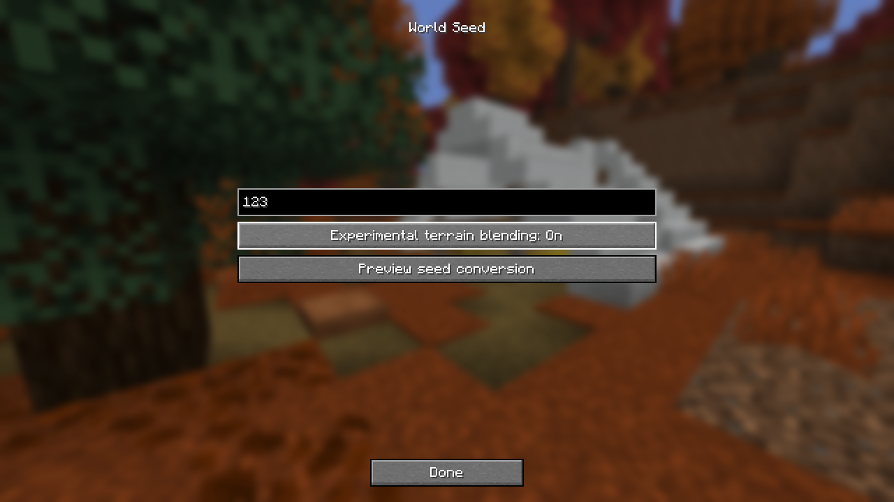
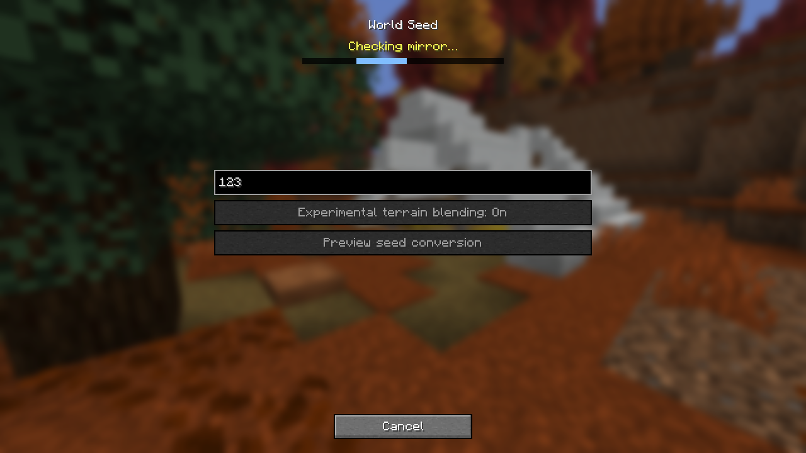
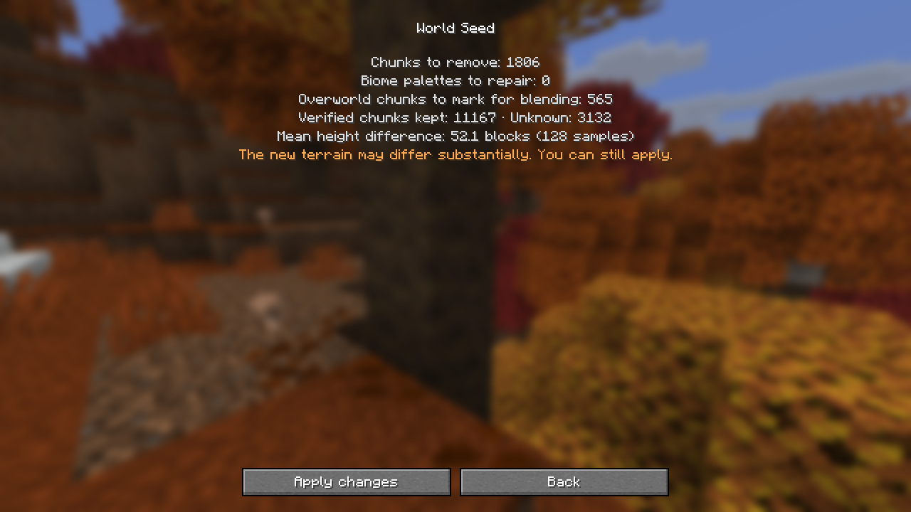
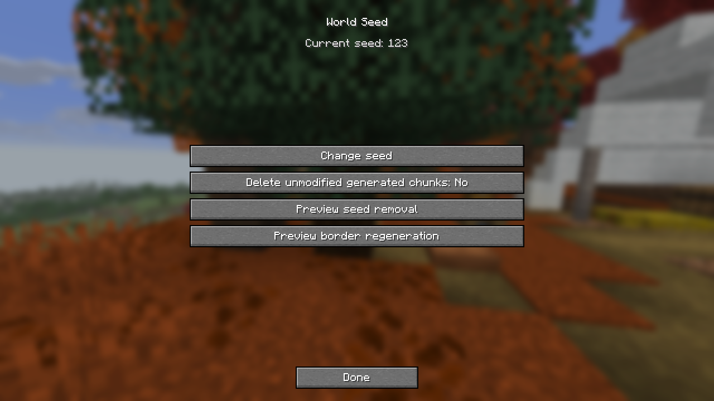

# Mirror seeds

Close the mirror, open **World Mirror Routes**, select the world in the graph, then open **World Seed**. Enter a number or text as you would when creating a Minecraft world.

The seed screen shows progress while inspecting and scanning the save. Use **Cancel** or Escape to stop a check. The scan reads a private copy of the chunk index, including any committed WAL entries. After confirmation, you can still cancel while the save is rechecked. Applying the verified changes runs to completion once staging starts.

The preview shows how many void placeholders will be removed and how many retained chunks need a biome palette change. The height comparison samples up to 128 columns in captured Overworld terrain against vanilla's normal preset. A mean difference of 12 blocks or more shows a warning. Datapacks that change vanilla world generation can affect the result.

Applying a seed switches the save to the native normal preset. World Mirror stores the seed in Minecraft's own generator settings and records the preset, generation batch and settings fingerprint in mirror metadata. It removes its unmodified void datapack and its references from the save's pack selection. It remaps the pack's biome IDs in retained chunks to plains, nether wastes or the End, as appropriate. Captured, imported, and edited terrain is preserved. Applying a first seed requires the owned World Mirror generator and its unmodified pack. Changing an assigned seed preserves the save's pack selection.

Verified void placeholders are cleared even if an earlier Minecraft upgrade added vanilla blending data or mixed vanilla biomes into them. Minecraft recalculates saved lighting next to newly generated terrain when those chunks load, regardless of the experimental terrain blending setting.

Minecraft can place features across chunk borders as it generates adjacent terrain. This can change blocks, such as ores, in already downloaded chunks.

When you open a mirror seeded by an earlier build, World Mirror uses its pre-conversion backup to identify leftover void chunks. It can recognize incoming water or lava and cobblestone from their contact along the old void edge. Verified unmodified seed terrain affected by old blending data can also regenerate. Watch the opening screen for scan, staging and backup progress. Keep the pre-conversion backup in the mirror's `backups` folder for this check. The repair backs up affected files and keeps captured terrain, edited chunks and chunks with ambiguous changes.

Open an older seeded mirror before changing its seed in a newer Minecraft version. The repair matches the conversion backup against the Minecraft data version recorded for the seed operation.

Applying a seed to a fresh World Mirror reservation creates the playable save and its metadata with the reserved identity. A recognized void mirror with missing metadata is registered as a standalone snapshot and keeps its existing SQLite namespace when there is exactly one. Opening the seed editor and previewing leave metadata unwritten.

To remove an assigned seed, preview the return to void generation. The default keeps existing terrain. The delete option only removes chunks from the current batch whose blocks, biomes and block entities still match their original generated contents and whose separate entity and POI data are safe to remove. The preview counts retained and unknown chunks separately. Terrain saved by a newer Minecraft version blocks the conversion. **Change seed** previews a replacement seed directly, keeps existing terrain and starts a new generation batch.

Experimental terrain blending applies in the Overworld. World Mirror marks captured or imported boundary chunks so Minecraft can blend them with neighboring terrain as it generates. For an existing seam, **Preview border regeneration** follows connected, unmodified chunks from a usable capture boundary, up to about seven chunks into the seed terrain. Applying that preview removes the eligible chunks so they regenerate when loaded. Edited or unknown chunks and chunks with entities or POI remain in place and can interrupt the transition.

Each operation rechecks the preview under the native save lock and creates a backup in the mirror's `backups` directory before publishing changes. An interrupted publication is recovered under the same lock. The seed fingerprint detects changes to the native settings made outside World Mirror.

Vanilla writes seed terrain with provenance recorded by Fabric. World Mirror adds a `seed_generated` SQLite row after the terrain is saved. The row has timestamp zero and a lower priority than captures or Replay imports. Built-in maps and overlays omit these rows, and nearby exports and captures from the opened mirror skip unmodified generated terrain. An edit permanently disqualifies the chunk from automatic seed terrain replacement, even after restoring the original blocks. The previous batch can still supply replaceable terrain after a seed change if its original provenance and contents can be verified. If the attachment is missing, World Mirror treats the terrain as unknown.
